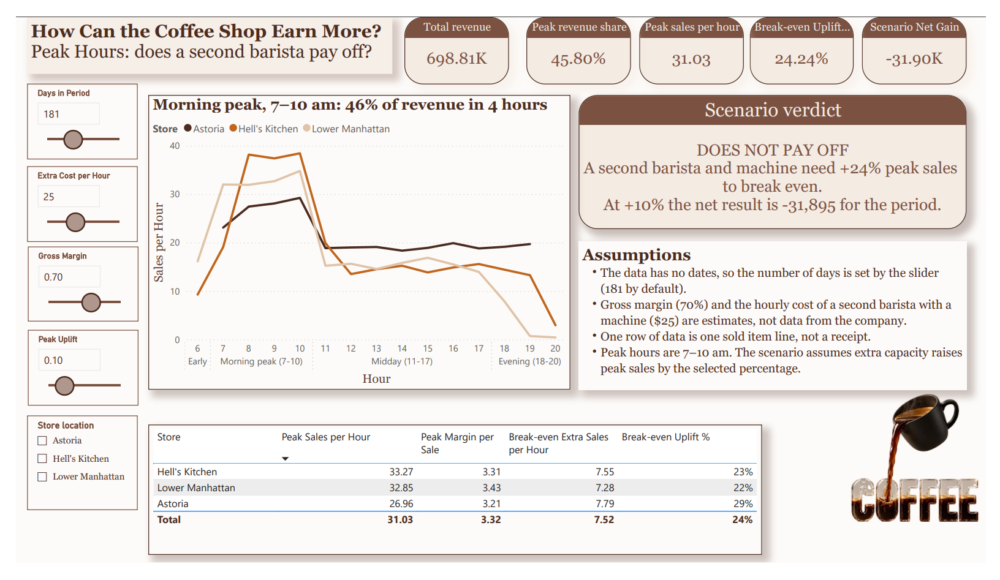
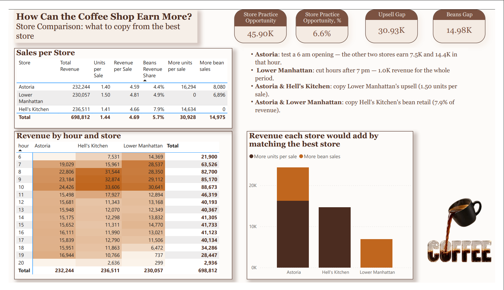

# How Can the Coffee Shop Earn More?

**[▶ Open the live interactive dashboard](https://app.powerbi.com/view?r=eyJrIjoiNWU0MDkxMTMtNGY2Zi00ZWY2LWIwNTQtM2YxMDRmYWYxNDRlIiwidCI6IjFkMjk4YmNmLWQ5OWMtNGVmYi1hMjA4LTgyNjI1OTNiNDk3YyIsImMiOjl9)**

Two-page Power BI report for a three-store coffee chain. It answers one question: where is the extra revenue — in the morning peak, or in levelling the stores?

## The answer
- **A second barista and coffee machine do not pay off** unless peak sales grow by 22–29%, depending on the store. At +10% the chain loses about 31.9K over the period.
- **Levelling the stores is worth about +45.9K (6.6% of revenue) with no extra cost:** +30.9K if every store sold as many units per sale as the best one, +15.0K if every store sold coffee beans like the best one.
- **Opening hours:** one store has no 6 am sales while the other two earn 7.5K and 14.4K in that hour; another earns 1.0K after 7 pm over the whole period.

## Report pages
| Page | Question | What it shows |
|---|---|---|
| Peak Hours | Does a second barista pay off? | Sales per hour by store, break-even analysis with what-if sliders, a verdict that rewrites itself as the sliders move |
| Store Comparison | What to copy from the best store? | Store KPIs, revenue heatmap by hour and store, revenue each store would add by matching the best one |

## Assumptions
The dataset has no dates and no costs, so three inputs are what-if parameters the reader can change:
- days in the period (181 by default);
- gross margin (70%);
- hourly cost of a second barista with a machine ($25).

One row of data is one sold item line, not a receipt.

## Techniques
- **Power Query:** star schema built from a single flat sheet (fact table plus Product, Store and Hour dimensions); Excel time serials converted to time
- **DAX:** break-even measures, scenario net gain, benchmark-against-best measures (`MAXX` over `ALL`), gap measures summed per store so totals reconcile, dynamic text verdict
- **What-if parameters:** four numeric-range parameters driving the scenario
- **Visuals:** grouped hour axis by daypart, matrix heatmap with conditional formatting

Files: [coffee-shop-earn-more.pbix](coffee-shop-earn-more.pbix) · [PDF export](coffee-shop-earn-more.pdf)

**Tools:** Power BI Desktop, Power BI Service, DAX, Power Query · **Data:** public sample dataset *Afficionado Coffee Roasters* (149,116 sales lines, 3 stores, 80 products)
